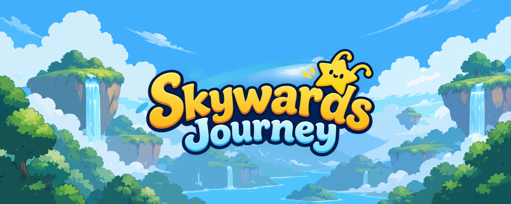
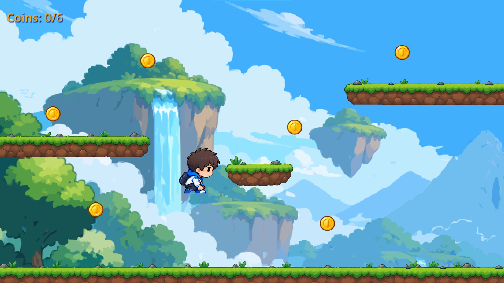
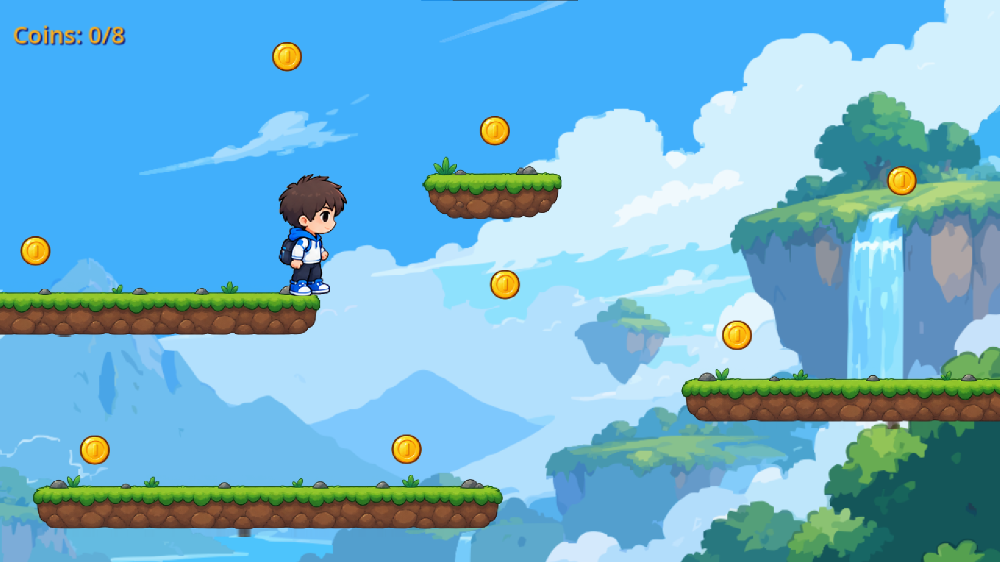

# SkyWards Journey




A small 2D platformer game made with **Godot**, featuring two levels, custom artwork, and classic platforming mechanics.

## Game Preview


## Features

- Two playable levels
- Classic platforming mechanics
- Custom digitally drawn artwork
- Available for Windows and web browsers

## Controls

| Action | Keyboard |
|---|---|
| Move Left / Backward | `A` or `Left Arrow` |
| Move Right / Forward | `D` or `Right Arrow` |
| Jump | `W` or `Spacebar` |

## Play the Game

Play SkyWards Journey on itch.io:

**[Play SkyWards Journey](https://yoruayan.itch.io/skywards)**

Available for Windows and web browsers.

## Screenshots





## Game Design and Credits

This game features digitally drawn artwork created collaboratively by **@KricoTheOg** and me.

- **Foreground artwork:** Created by me.
- **Background and character artwork:** Created by @KricoTheOg.

Thanks to @KricoTheOg for contributing to the game's visual design.

## Project Structure

```text
star-game/
├── .godot/                   # Godot editor cache
├── Assets/                   # Game assets
├── gd/                       # GDScript files
├── Player animation assets/  # Player animation resources
├── Screenshorts/             # README screenshots
├── tscn/                     # Godot scene files
│   ├── coin.tscn
│   ├── final_level.tscn
│   ├── level.tscn
│   └── title_scren.tscn
├── Web Build/                # Web export
├── .editorconfig
├── export_presets.cfg
├── project.godot             # Godot project configuration
└── README.md
```

## Built With

- [Godot Engine](https://godotengine.org/)

---

If you enjoy the game, consider giving the repository a star.
